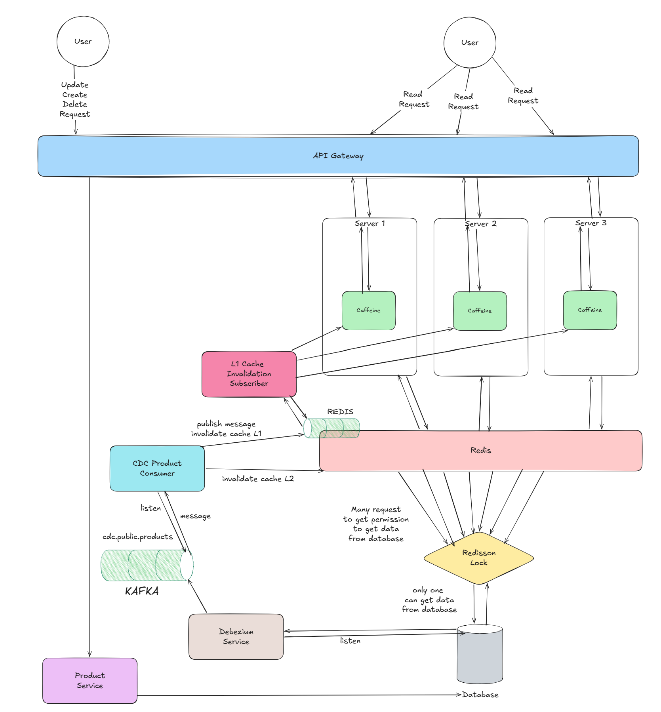
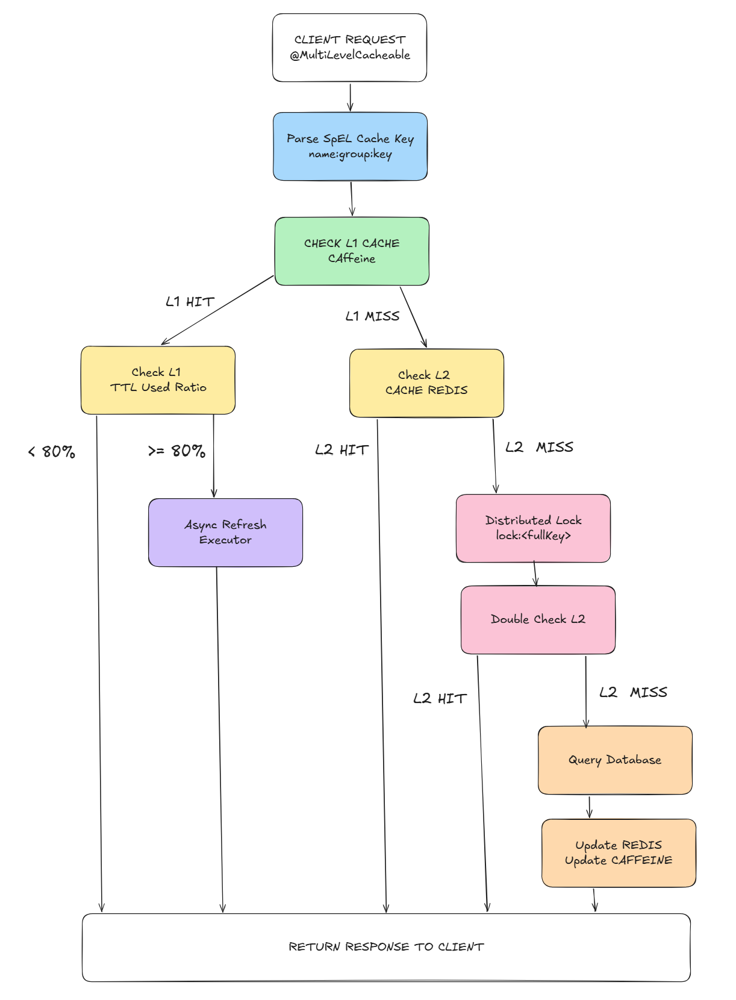
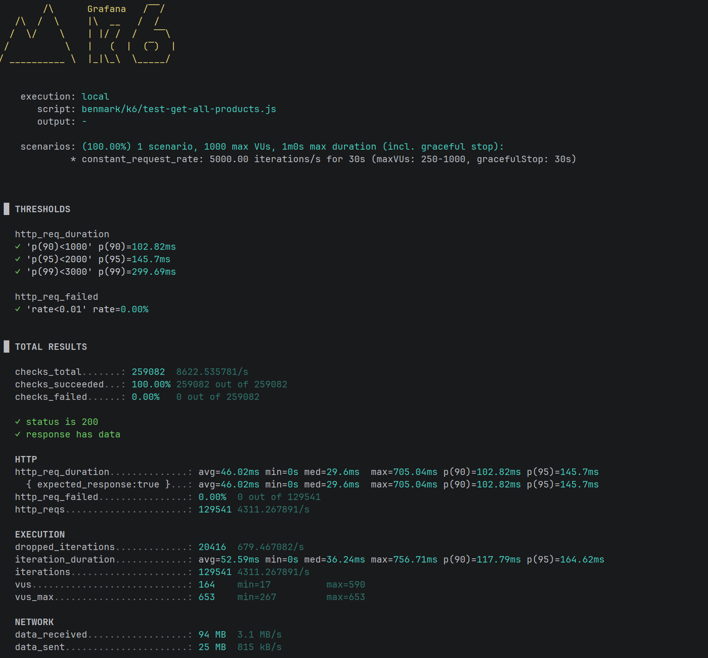
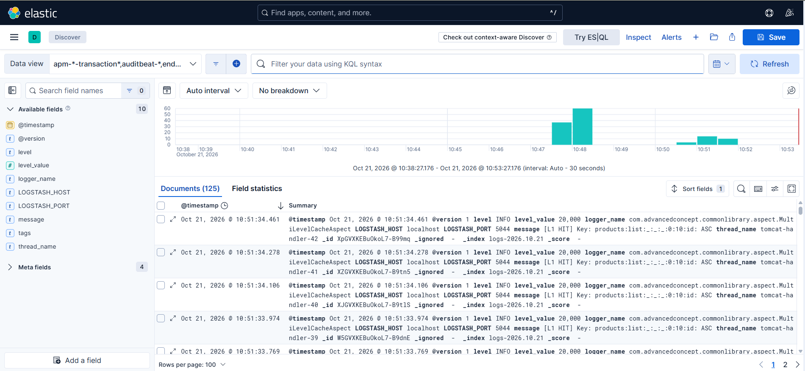
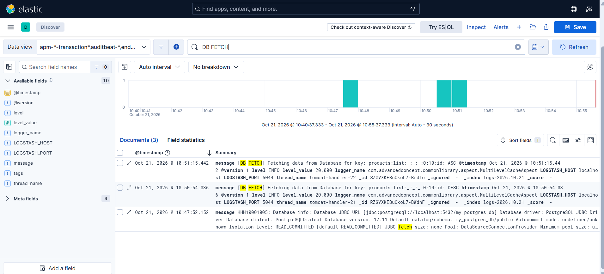

# evaluate-advanced-concept
An enterprise-grade, event-driven multi-tier caching architecture (L1 Caffeine + L2 Redis) built with Spring Boot, featuring Redisson distributed locking to prevent cache stampede, Debezium CDC & Kafka for near real-time cache synchronization, and full-stack observability via Prometheus, Grafana, Tempo, and Logstash.

Engineered a resilient, low-latency distributed caching framework designed to handle high-concurrency read/write
workloads while maintaining strict data consistency between cache tiers and the database:
- Two-Level Caching Strategy: Combines in-memory L1 Caffeine (microsecond latency per instance) and distributed L2 Redis (shared state) to optimize resource consumption and maximize throughput.
- Cache Breakdown & Stampede Defense: Utilizes Redisson distributed locks to ensure only a single concurrent request queries the persistent database during cache-miss spikes, shielding the primary database from sudden traffic surges.
- Event-Driven Invalidation via CDC: Implements an asynchronous cache-aside pattern powered by Debezium CDC and Apache Kafka. On database updates, CDC events trigger immediate L2 eviction and publish fan-out messages to Redis channels, prompting all active L1 nodes to evict stale entries near real-time.
- End-to-End Telemetry & Centralized Logging: Instrumented full observability infrastructure utilizing Prometheus for metrics collection, Grafana for dashbording, Grafana Tempo for distributed tracing across network hops, and Logstash for centralized, structured log aggregation.

## 1. Overall Architecture



## 2. Distributed Caching and Refresh Ahead Method

| Configuration              | Default Value | Description                                                    |
|----------------------------|---------------|----------------------------------------------------------------|
| L1 TTL                     | 150 seconds   | Logical time-to-live for Caffeine entries                      |
| L2 TTL                     | 1,800 seconds | Time-to-live for Redis entries                                 |
| Refresh Ahead Threshold    | 80% of L1 TTL | Triggers asynchronous refresh when L1 data reaches this age    |
| Executor Core Pool Size    | 4 threads     | Number of core background worker threads                       |
| Executor Maximum Pool Size | 10 threads    | Maximum number of background worker threads                    |
| Executor Queue Capacity    | 500 tasks     | Maximum number of queued refresh tasks                         |
| Normal Cache Lock Wait     | 5 seconds     | Maximum time to wait when acquiring the cache-load lock        |
| Lock Lease Time            | 10 seconds    | Lock expiration time for normal cache loading                  |
| Refresh Lock Wait          | 0 seconds     | Does not wait if another thread already holds the refresh lock |
| Refresh Lock Lease Time    | 10 seconds    | Lock expiration time for asynchronous refresh                  |

Key Scenarios
- L1 HIT: Return the result immediately. If at least 80% of the L1 TTL has elapsed, trigger an asynchronous refresh.
- L2 HIT: Retrieve data from Redis, update the Caffeine cache, and then return the result.
- L1 MISS + L2 MISS: Acquire a distributed lock and re-check Redis before querying the database; this helps prevent a "cache stampede."
- Lock acquisition failure: Wait for 100 ms and attempt to read from Redis again; if it is still a MISS, return null.
- Database returns null: Do not write any data to either L1 or L2.



## 3. Demo

## 3.1 K6 Test Benchmark

- Test benchmark for 5000 requests / second in 30 continuous seconds.
- Only 1 server.
- CORE i5
- 8th Gen

| http_req_duration | p(x)           |
|-------------------|----------------|
| p(90)<1000        | p(90)=102.82ms |
| p(95)<2000        | p(95)=145.70ms |
| p(99)<3000        | p(99)=299.69ms |



## 3.2 Grafana

## 3.3 Logstash

### 3.3.1 Overall Logstash Dashboard



### 3.3.2 Db Fetch

- Spamming 1000 requests to 2 get list api.
- And there are only 2 `[DB FETCH]` messages.



## 4. Monitoring & Observability Structure

```
evaluate-advanced-concept/
│
├── commonlibrary/
│   ├── src/main/resouces/
│   │   ├── application.yml
│   │   └── logback-spring.xml
│   └── pom.xml
│
├── deployment/
│   ├── elk/
│   │   ├── pipeline/
│   │   │   └── logstash.conf
│   │   ├── elasticsearch.yaml
│   │   ├── kibana.yaml
│   │   └── logstash.yaml
│   ├── collector/
│   │   └── otel-collector-config.yaml
│   ├── prometheus/
│   │   └── prometheus.yaml
│   ├── tempo/
│   │   └── tempo.yaml
│   ├── grafana/
│   │   └── grafana-datasources.yaml
│   └── opentelemetry/
│       ├── opentelemetry-javaagent.jar
│       └── opentelemetry-config.properties
│
├── benmark/
├── http/
├── postgres_data/
├── Dockerfile
├── .dockerignore
└── docker-compose.yml

```

### 4.1 Prometheus Collecting Data Workflow

```
Spring Boot
    │
    │ OTLP
    ▼
otel-collector:4317
    │
    │ Prometheus exporter
    ▼
otel-collector:8889
    │
    │ scrape
    ▼
Prometheus:9090

```

### 4.2 Tempo Collecting Data Workflow

```
Spring Boot (OpenTelemetry Javaagent)
    │
    │ OTLP gRPC (traces)
    ▼
otel-collector:4317
    │
    │ OTLP gRPC exporter
    ▼
tempo:4317
    │
    │ Query (Port 3200)
    ▼
Grafana:3000
```

### 4.3 Logstash Collecting Data Workflow

```
Spring Boot (Logback TCP appender)
    │
    │ JSON over TCP
    ▼
logstash:5044
    │
    │ Pipeline process & output
    ▼
elasticsearch:9200
    │
    │ Query & Visualize
    ▼
Kibana:5601
```
